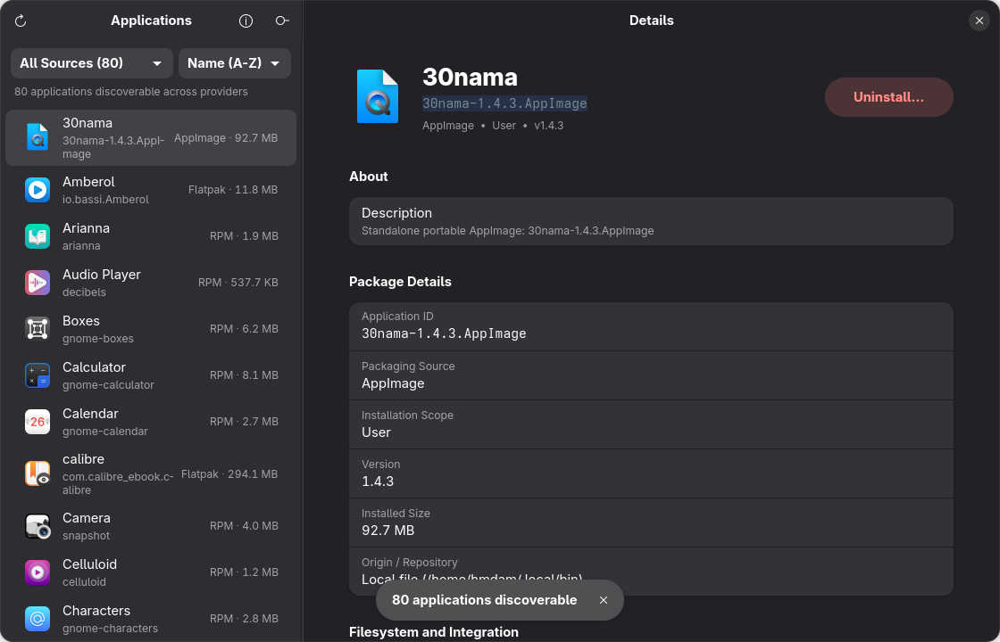

<div align="center">


# AppHarbor

### The Universal Linux Application Manager & Safe Uninstaller

**Discover, inspect, and safely remove applications across Flatpak, Snap, AppImage, RPM, DEB, Pacman, Zypper, and manual launchers in one native GNOME interface.**

[](https://github.com/appharbor/appharbor/releases)
[](https://github.com/appharbor/appharbor/actions/workflows/ci.yml)
[](LICENSE)
[](https://gitlab.gnome.org/GNOME/libadwaita)
[](https://www.python.org/)
[](https://kernel.org)

<br/>

<a href="docs/screenshots/appharbor-main.png">
  
</a>

</div>

---

## 🧭 Why AppHarbor?

On modern Linux desktops, applications come from everywhere:
* **Sandboxed packages** from Flathub (`Flatpak`) and the Snap Store (`Snap`).
* **Distribution packages** (`RPM`, `DEB`, `Pacman`, `Zypper`) from system repositories.
* **Portable binaries** (`AppImage`) saved into `~/Applications` or `~/.local/bin`.
* **Manual installations**, developer tarballs, and custom desktop launchers.

Traditional software centers typically only reveal what is available to install through their specific backend, while system package managers list thousands of obscure shared libraries, drivers, and headless daemons.

**AppHarbor unifies all your user-facing desktop applications into a single, cohesive view.** Built in the spirit of GNOME Circle utilities like **Warehouse** and **Flatseal**, AppHarbor adheres strictly to the GNOME Human Interface Guidelines (HIG) with full adaptive layout, dark mode, and zero web styling hacks.

---

## ✨ Key Features

* **Universal Multi-Format Discovery:** Automatically scans and inventories Flatpak, Snap, AppImage, RPM/DNF, DEB/APT, Pacman, Zypper, and manual `.desktop` launchers.
* **Accurate Scope Attribution:** Distinguishes between package format (`Source`) and installation boundary (`System-wide` vs `Per-User`).
* **Deep Disk Usage & Metadata Inspection:** View accurate installed size, executable paths, version strings, application summaries, and runtime permissions.
* **Safe, Explicit Uninstallation:**
  * **Data Preservation by Default:** User preferences and configuration files (`~/.config`, `~/.var/app`, `~/.local/share`) are kept intact unless you explicitly opt into removing them.
  * **Transparent Action Preview:** Displays exactly which commands and directories will be affected before any uninstallation begins.
  * **Never `rm -rf *`:** All uninstallation paths are strictly validated against directory traversal and protected roots.
* **Critical System Component Guard:** Protects the operating system from catastrophic mistakes by blocking removal of critical packages (e.g., `kernel`, `glibc`, `systemd`, `dnf`, `apt`, `gnome-shell`).
* **Strict Process Security:** Zero shell injection (`shell=False` everywhere). Root elevation uses system-managed **Polkit** (`pkexec`) prompts—passwords are never captured or handled by AppHarbor.
* **Pure GNOME HIG & Libadwaita:** Adaptive 2-pane navigation split view (`Adw.NavigationSplitView`), search filter dropdowns, and responsive layouts for desktop, tablet, and mobile displays.

---

## 📊 Supported Formats Matrix

| Package Ecosystem | Status | Scan & Discovery | Accurate Size | Safe Uninstall | Scope Attribution | Root Elevation |
| :--- | :---: | :---: | :---: | :---: | :---: | :---: |
| **Flatpak** | Supported | Yes | Yes | Yes (CLI/Portal) | System & User | Not Needed (User) / Polkit |
| **Snap** | Supported | Yes | Yes | Yes (`snap remove`) | System | Polkit / Sudo |
| **AppImage** | Supported | Yes | Yes | Yes (File + Trash) | System & User | Polkit (if System) |
| **RPM / DNF** (Fedora, RHEL) | Supported | Yes | Yes | Yes (`dnf remove`) | System | Polkit / Sudo |
| **DEB / APT** (Ubuntu, Debian) | Supported | Yes | Yes | Yes (`apt purge/remove`) | System | Polkit / Sudo |
| **Pacman** (Arch, Manjaro) | Supported | Yes | Yes | Yes (`pacman -R`) | System | Polkit / Sudo |
| **Zypper** (openSUSE) | Supported | Yes | Yes | Yes (`zypper rm`) | System | Polkit / Sudo |
| **Manual `.desktop` Launchers** | Supported | Yes | Yes | Yes (Trash/Clean) | System & User | Polkit (if System) |

---

## 🚀 Installation

### 1. Prebuilt Packages (Recommended)

Download ready-to-install packages from the **[GitHub Releases](https://github.com/appharbor/appharbor/releases)** page:

#### Fedora / RHEL / CentOS Stream (`.rpm`)
```bash
sudo dnf install ./appharbor-*.noarch.rpm
```

#### Ubuntu / Debian / Linux Mint (`.deb`)
```bash
sudo apt install ./appharbor_*_all.deb
```

---

### 2. Arch Linux / Manjaro (AUR)

Build directly with `makepkg`:
```bash
git clone https://github.com/appharbor/appharbor.git
cd appharbor/packaging/arch
makepkg -si
```

---

### 3. Flatpak

You can build and install a sandboxed bundle using `flatpak-builder`:
```bash
git clone https://github.com/appharbor/appharbor.git
cd appharbor
flatpak-builder --user --install --force-clean build-dir packaging/flatpak/io.github.appharbor.AppHarbor.yml
```

---

### 4. Running from Source

You can run AppHarbor directly on any Linux distribution with Python 3.10+, GTK 4, and Libadwaita installed:

#### Fedora / RHEL
```bash
# 1. Install system runtime libraries
sudo dnf install python3-gobject gtk4 libadwaita

# 2. Clone and launch
git clone https://github.com/appharbor/appharbor.git
cd appharbor
python3 main.py
```

#### Ubuntu / Debian / Linux Mint
```bash
# 1. Install system runtime libraries
sudo apt update
sudo apt install python3-gi gir1.2-gtk-4.0 gir1.2-adw-1

# 2. Clone and launch
git clone https://github.com/appharbor/appharbor.git
cd appharbor
python3 main.py
```

#### Arch Linux
```bash
# 1. Install system runtime libraries
sudo pacman -S python-gobject gtk4 libadwaita

# 2. Clone and launch
git clone https://github.com/appharbor/appharbor.git
cd appharbor
python3 main.py
```

---

## 🛡️ Safety & Security Architecture

AppHarbor is designed with defensive security guarantees at every layer:

```
┌────────────────────────────────────────────────────────┐
│                   AppHarbor UI                         │
│            (Unprivileged User Process)                 │
└──────────────────────────┬─────────────────────────────┘
                           │
             ┌─────────────┴─────────────┐
             ▼                           ▼
  [Inventory Orchestrator]      [Uninstall Service]
  • Read-only scans             • Safety Checks & Plan
  • No elevated privileges      • Critical Package Guards
                                         │
                        ┌────────────────┴────────────────┐
                        ▼                                 ▼
             [User Scope Actions]              [System Scope Actions]
             • Flatpak user-uninstall          • Polkit (pkexec)
             • AppImage deletion               • Native Package Manager
             • User .desktop removal           • Zero password interception
```

1. **Defense Against Unsafe Deletions:**
   * Before any uninstallation begins, `appharbor.system.guards` validates the target against a strict deny-list of essential packages (`kernel`, `glibc`, `systemd`, `bash`, `coreutils`, `shadow-utils`, `sudo`, `polkit`, `xorg`, `wayland`, `gnome-shell`, `mesa`, and package managers).
2. **Subprocess Isolation:**
   * Commands are executed strictly through argument vectors (`execvp`) with `shell=False`. Arguments are never concatenated into shell strings, completely eliminating command injection vulnerabilities.
3. **Privilege Elevation via Polkit:**
   * When modifying system packages, AppHarbor invokes standard `pkexec` or package manager elevation mechanisms. The application never asks for root passwords, never creates setuid binaries, and runs with standard user permissions.
4. **Data Preservation:**
   * Application configurations (such as Flatpak sandbox data in `~/.var/app/` or local configs in `~/.config/`) are preserved by default. Removing application data requires an explicit opt-in checkbox that itemizes every target directory.

---

## 🧪 Testing & Code Quality

AppHarbor includes an automated test suite verifying providers, security guards, uninstall plans, and UI models:

```bash
# Run all unit and safety tests
pytest -v

# Validate desktop launcher entry
desktop-file-validate data/io.github.appharbor.AppHarbor.desktop

# Validate AppStream metainfo specification
appstreamcli validate --no-net data/io.github.appharbor.AppHarbor.metainfo.xml
```

---

## 🤝 Contributing

Contributions, bug reports, and provider requests are very welcome!
* Read [CONTRIBUTING.md](CONTRIBUTING.md) for architectural guidelines and coding standards.
* Follow our [Code of Conduct](CODE_OF_CONDUCT.md).
* Report security vulnerabilities responsibly as described in [SECURITY.md](SECURITY.md).

---

## 📄 License

AppHarbor is free and open-source software licensed under the [MIT License](LICENSE).
Built with ❤️ for the Linux desktop community.
